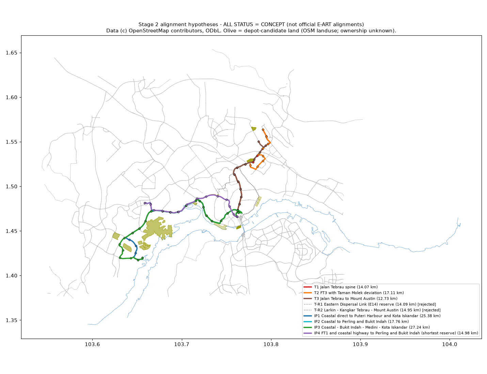

# Stage 2 results: option comparison

**Run:** `stage2-alignments` run 41886438950 at commit `b1295bb` (2026-11-04). Outputs are
committed in `c908890`. A local rerun on the same inputs reproduced the comparison table
exactly.

**Status:** every line and station is `concept`, and every screen value is `inferred`.
None of this is official. No field observations were made. Method: [`README.md`](README.md).

Shared sections overlap on the map. T1 (red) is hidden under T3 as far as Tebrau City, and IP2 (cyan) under IP3. Use the GeoJSON for each option's full line.

## 1. Comparison table

Source: `results/stage2/option_comparison.csv`. "Floor-area proxy" is the unique building
footprint × levels within an 800 m network walk of all stations, in km². It measures
built-up activity. It is not population or jobs; Stage 3 replaces it with DOSM-based
measures.

| | T1 | T2 | T3 | T-R1 | T-R2 | IP1 | IP2 | IP3 | IP4 |
|---|---|---|---|---|---|---|---|---|---|
| Decision | carried | carried | carried | **rejected** | **rejected** | carried | carried | carried | carried |
| Route | FT3: Jalan Tebrau, Jalan Pandan, Jalan Kota Tinggi to Desa Tebrau | FT3 with Taman Molek deviation | FT3 to Tebrau City, then Mount Austin | EDL expressway (E14) | Larkin, Kangkar Tebrau, Mount Austin | Coastal (J1 + Iskandar Coastal Hwy) to Puteri Harbour and Kota Iskandar | Coastal to Bukit Indah | Coastal, Bukit Indah edge, Medini, Kota Iskandar | FT1 + Iskandar Coastal Hwy to Bukit Indah (shortest reserve) |
| Length (km) | 14.07 | 17.11 | 12.73 | 14.09 | 14.95 | 25.38 | 17.76 | 27.24 | 14.98 |
| vs. reported (14.0 / 14.78 km) | +0.5% | **+22%** | -9.1% | +0.7% | +6.8% | **+72%** | **+20%** | **+84%** | +1.3% |
| Within ±15% | yes | no | yes | yes | yes | no | no | no | yes |
| Stations / mean spacing (m) | 15 / 1005 | 18 / 1006 | 13 / 1061 | 13 / 1174 | 15 / 1068 | 23 / 1154 | 17 / 1110 | 25 / 1135 | 14 / 1152 |
| Floor-area proxy (km²) | 5.15 | 5.69 | 5.12 | 3.57 | 4.76 | 5.52 | 5.46 | 6.77 | 3.45 |
| Median network catchment ratio | 0.32 | 0.37 | 0.38 | 0.30 | 0.37 | 0.27 | 0.30 | 0.27 | 0.29 |
| Stations with ratio < 0.35 (V2 flag) | 8 | 8 | 4 | 9 | 7 | 17 | 11 | 17 | 9 |
| Median BAS.MY routes ≤400 m walk | 3 | 1.5 | 3 | 1 | 2 | 0 | 0 | 0 | 0 |
| Share on dual carriageway | 1.00 | 1.00 | 1.00 | 0.99 | 0.87 | 1.00 | 0.99 | 1.00 | 1.00 |
| Narrow cross-section spans | 1 | 1 | 2 | 2 | 5 | 3 | 3 | 3 | 1 |
| Curve spans with radius < 100 m | 3 | 10 | 3 | 7 | 17 | 11 | 9 | 13 | 4 |
| Existing flyover spans on route | 6 | 6 | 5 | 8 | 5 | 10 | 7 | 9 | 6 |
| Rail / river crossings | 9 | 9 | 9 | 12 | 9 | 11 | 11 | 12 | 8 |
| Max ground grade (200 m, DSM) | 6.2% | 6.1% | 6.2% | 5.5% | 5.8% | 6.6% | 6.6% | 6.6% | 4.5% |
| Line in JRC RP100 extent | 0% | 0% | 0% | 2.5% | 0% | 2.0% | 2.8% | 1.8% | 3.0% |
| Line low-lying near water (proxy) | 5.0% | 4.1% | 5.5% | 5.0% | 5.3% | 5.3% | 7.6% | 5.0% | 8.7% |
| Stations flagged for flood | 1 | 1 | 1 | 1 | 0 | 1 | 1 | 1 | 0 |
| Depot land ≥8 ha within 1.5 km | 3 | 3 | 3 | 5 | 3 | 10 | 4 | 10 | 3 |
| Anchor not served (>500 m) |  |  |  |  |  | Perling |  | Bukit Indah | Perling |

The "rail crossings" counts include the KTM line and the RTS Link viaduct at about 0.3 km
from Bukit Chagar on every option. Each option's first segment must cross over or under
both. Parallel tracks are counted separately.

## 2. Findings

### Tebrau

1. **The FT3 spine (T1) matches the reported 14 km almost exactly** (14.07 km, +0.5%). It
   follows Jalan Tebrau, then Jalan Pandan and Jalan Kota Tinggi, to Desa Tebrau.
   - It is 100% dual carriageway, with only 1 narrow span (at Bukit Chagar itself) and 3
     tight-curve spans.
   - This agreement is consistent with the official Tebrau line following FT3. It does
     **not** show that the official line does; another route of similar length could exist.
2. **T2 (Taman Molek deviation)** adds the most floor area (+0.5 km², +10%). It is 3 km
   longer (+22%, outside the band) and has 10 tight-curve spans instead of 3.
3. **T3 (Mount Austin end)** is shorter (12.7 km). It has the best median catchment ratio
   (0.38, with only 4 stations below 0.35) and ties T1 on bus connection (median 3 routes).
4. **T-R1 (EDL expressway) is rejected on the numbers.** It is the same length as T1 but has:
   - 31% less floor area (3.57 vs. 5.15 km²);
   - the lowest Tebrau catchment ratio (0.30);
   - a median of 1 BAS.MY route within 400 m of a station, vs. 3 for T1;
   - the most flyover and river conflicts (8 and 12).
5. **T-R2 (Larkin) is rejected on scope** (Skudai corridor, owner decision 2). It also
   has the most narrow spans (5) and tight curves (17); 13% of it runs on single-carriageway local roads.

### Iskandar Puteri

1. **No single line from Bukit Chagar to Kota Iskandar or Puteri Harbour can be ~14.78 km
   on road reserves.**
   - The shortest road distance is 20.9 km to Kota Iskandar and 22.0 km to Puteri Harbour,
     using all drivable roads with no preference weights
     (`results/stage2/ip_shortest_road_km.json`).
   - That is 41–49% over the reported length.
   - IP1 (coastal, 25.4 km) and IP3 (27.2 km) are 72–84% over.
2. **The shortest road distance from Bukit Chagar to Bukit Indah is 14.77 km**, which
   equals the reported 14.78 km. IP4 follows that reserve (FT1, then the Iskandar Coastal
   Highway, then Perling) and comes out at 14.98 km (+1.3%).
   - This is a strong hint that the 2024 "Iskandar Puteri line" length describes a Bukit
     Chagar–Bukit Indah line, or a line starting elsewhere.
   - It remains an **inference** (A-036). Coincidences are possible, and the official
     alignment is unpublished.
3. **IP4's catch:**
   - Its first ~6 km on FT1 (Jalan Tun Abdul Razak, past Taman Dato Onn) is the reserve a
     Skudai–Tampoi–Larkin line would also likely use.
   - It has the lowest floor-area proxy (3.45 km²), and no BAS.MY routes at the median
     station.
   - It passes 2.4 km from Perling Mall, so Perling's center is not served.
4. **IP2 (coastal J1 to Bukit Indah)** avoids FT1, serves Danga Bay, and has 58% more floor
   area than IP4 (5.46 km²). It is 17.8 km (+20%).
5. **Only the coastal options reach the administrative center** (IP1, IP3). They do so at
   25–27 km, with the most flyover conflicts (9–10) and the poorest catchment ratios
   (0.27).
6. **IP options are weak on walk access.** Their median catchment ratios are 0.27–0.30, and
   9–17 stations per option fall below V2's 0.35 flag. Coastal-highway frontage has few
   walk links.

### Bukit Chagar interchange (shared by all options)

1. **All options start at the same road node beside the RTS station** (27 m from the OSM
   station node). Within the first 0.3 km each must cross the KTM line and the RTS viaduct.
   The interchange station abuts the RTS/ICQ structure (IP4 and T-R2 start: 0 m façade
   setback). This is a Stage 4 design question, not something Stage 2 can resolve.
2. **Walk distances from the E-ART station point on the current OSM network:**

   | Destination | Network walk | Straight line | Detour |
   |---|---|---|---|
   | JB Sentral (KTM) | 929 m | 444 m | 2.1× |
   | JB Sentral bus terminal | 1,125 m | 434 m | 2.6× |
   | ICQ building | 1,390 m | 121 m | 11.5× |

   The ICQ detour reflects missing or construction-stage links in OSM, not a measured
   walk.
3. **V4-alt (OSM pedestrian audit): FAIL.**
   - (a) **NOT EVALUABLE:** no station entrances are mapped.
   - (b) **FAIL:** 2 of 18 desire-line road crossings are mapped (11%; threshold 90%).
   - (c) **FAIL:** 1 of 6 grade changes is tagged.

   Source: `results/stage2/v4alt_bukit_chagar.json`. Consequence: Stage 3 and Stage 4 walk
   times at Bukit Chagar on raw OSM are unreliable and probably too long. See the handoff
   for the proposed handling.

## 3. Pinch-point list (SC-4 web-only substitute)

Full list: `results/stage2/pinch_points.csv`, with 273 rows covering narrow
cross-sections, tight curves, crossings, flyovers, and steep ground. Priority items for
the carried options:

| Option(s) | Location (lon, lat) | Type | Evidence |
|---|---|---|---|
| All | 103.7617, 1.4664 (Bukit Chagar, 0–0.2 km) | Façade within 15 m; interchange abuts RTS/ICQ; crosses KTM + RTS viaduct | OSM footprints, rail geometry |
| IP1–IP3 | 103.7659, 1.4704 (Jalan Bukit Chagar, 1.0 km) | Façade 8.8 m from route | OSM footprints |
| IP1–IP3 | 103.7461, 1.4636 (Jalan Lingkaran Dalam, 4.1 km) | Façade 9.6 m from route; KTM crossing at 2.5 km | OSM footprints, rail geometry |
| T3 | 103.7814, 1.5307 (Jalan Pandan, 9.2 km) | Façade 13 m from route, at a station | OSM footprints |
| T1, T3 | 103.7993, 1.5488 / 103.7938, 1.5455 (Tebrau City junctions) | Curve radius 25–26 m | Route follows the junction; a guideway needs a wider arc and some land take |
| IP2 | 103.7671, 1.4701; 103.7438, 1.4614; 103.7179, 1.4853 | Curve radius 20–45 m | Same |
| IP2, IP4 | 103.6664, 1.4724 to 103.6610, 1.4806 (Perling and Bukit Indah approach) | Three curves of 25–36 m | Same |
| T1–T3 | Jalan Tebrau / Jalan Pandan / Jalan Johor Jaya | 5–6 existing flyover spans | OSM `bridge`/`layer`; the guideway must pass over (taller piers) or beside them |
| IP1–IP4 | Lebuhraya Pesisir Pantai Iskandar, Jalan Lingkaran Dalam, Lebuh Kota Iskandar | 6–10 existing flyover spans | Same |
| T1–T3 | Sungai Tebrau, Sungai Tampoi | River crossings | OSM waterways |
| IP1–IP4 | Sungai Danga, Sungai Kempas (and Sungai Segget for IP4) | River crossings | OSM waterways |

The FT3 and coastal spines are wide. The median building-to-building width is 110–120 m; rays are capped at 60 m per side, so 120 m means no building within 60 m on either side.
Viaduct *space* is mostly not the binding constraint. The binding constraints are:
- junction curves;
- existing flyovers;
- the Bukit Chagar approach, where the KTM line, the RTS viaduct, and the ICQ meet.

Because no field check was possible, all of these are screening-level.

## 4. Flood-spot list (SC-5 web-only substitute)

Full list: `results/stage2/flood_spots.csv`. The JRC layer covers river flooding only.
JB's recurrent problem is flash and tidal flooding, which no free layer maps, so the
**news leads** below matter as much as the model screens.

| Location | Options | Screen | News lead (lead only) |
|---|---|---|---|
| Sungai Danga / Teluk Danga, 103.701–103.716, 1.474–1.485 (coastal highway) | IP1–IP4 | JRC RP100 extent on 300 + 150 + 50 m of line (IP4: 300 + 100 + 50 m); station IP1/IP2/IP3-S10 low-lying (DSM 3.2 m, 27 m from water) | Danga Bay / Jalan Skudai flooded Dec 2025 (SRC-052) |
| Jalan Pandan near Sungai Tebrau, 103.7746, 1.5053 | T-R1 (EDL) | JRC RP100 extent, 250 m; station T-R1-S06 low-lying | Sungai Tebrau hotspot; RM41m mitigation (SRC-049) |
| Jalan Pandan, 103.7621, 1.5210 | T1–T3 (station S08) | Low-lying proxy: DSM 4.9 m, 49 m from a mapped waterway | Sungai Tebrau area (SRC-049) |
| Jalan Tebrau / Jalan Pasir Pelangi / Jalan Serampang / Jalan Bakar Batu (city to Southkey) | T1–T3 (FT3 0–6 km) | Low-lying proxy spans only | Flooded May 2022 (SRC-048); 18 of 35 MBJB hotspots reported fixed (SRC-050) |
| Taman Perling | IP2, IP4 | Low-lying proxy | Perling flash floods Sep 2026 (SRC-051) |
| Jalan Wong Ah Fook (Bukit Chagar walk desire line) | Interchange | Not on the line | Flooded Sep 2026 (SRC-051) |

One station is flagged on each of T1–T3 (the shared S08 on Jalan Pandan) and on each
coastal IP option (S10 near Sungai Danga). IP4 has no flagged station.

## 5. Depot candidates

Source: `data/concept/depot-candidates.geojson`; status `inferred`. OSM shows land cover,
not ownership or availability. SRC-043 reports that depots are still being agreed with the
state.

- **Tebrau:** a 26.8 ha `natural=heath` parcel tagged "Kampung Penggawa Timur", 21 m from
  the line at 8.5 km. The name suggests a village, so it may not be vacant. A 15.3 ha
  parcel lies 0.85 km from the Desa Tebrau terminus.
- **Iskandar Puteri:**
  - Brownfield plots near Puteri Harbour ("Estuari", 10–22 ha) and plantation (`orchard`)
    land near Bukit Indah and Medini (7–553 ha).
  - The 53 ha "Lido Waterfront Boulevard" greenfield beside the coastal route is
    reclaimed waterfront that is probably committed to development.
- **Rejected as depot land:** the Royal Johor Polo Club grass (club use).

## 6. Rejected options (with reasons)

| ID | Option | Reason |
|---|---|---|
| T-R1 | EDL expressway reserve | Worst walk access of all Tebrau options (above). An existing elevated expressway gives frontage access only at interchanges. |
| T-R2 | Larkin–Kangkar Tebrau–Mount Austin | Out of scope (Skudai corridor, owner decision 2). Also the worst cross-section and curve record. |
| IP-R1 | FT1 through Tampoi to Bukit Indah | Skudai corridor geometry (owner decision 2). Not drawn. |
| IP-R2 | Second Link Expressway (E3) | Controlled-access: no walkable frontage. Not drawn. |
| T-R3 | Anything from James Clark's map | Excluded source (SRC-031) |

## 7. What these results do not say

- They do not say any option is buildable, or that the official alignment looks like any
  of them.
- They do not rank corridors by benefit. Access is Stage 3, and the V10 priority test is
  Stage 5.
- Grades come from a surface model that includes buildings and trees. No option exceeds 8%
  on smoothed ground. That is a screen, not a profile.

## 8. Selection for Stage 3 (2026-11-14)

The owner delegated the choice (see `docs/handoffs/stage-2.md`, decision 2).

| Scenario | Base | Variants and sensitivities | Dropped |
|---|---|---|---|
| B (Tebrau) | T1 | T2, T3 | T-R1, T-R2 (rejected) |
| C (Iskandar Puteri) | IP2 | IP4 (matches the reported length), IP1 (reaches Kota Iskandar) | IP3 |

Selection does not change status: all of these remain `concept`.
